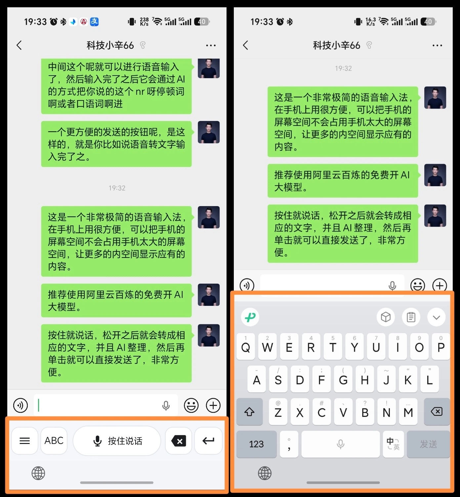
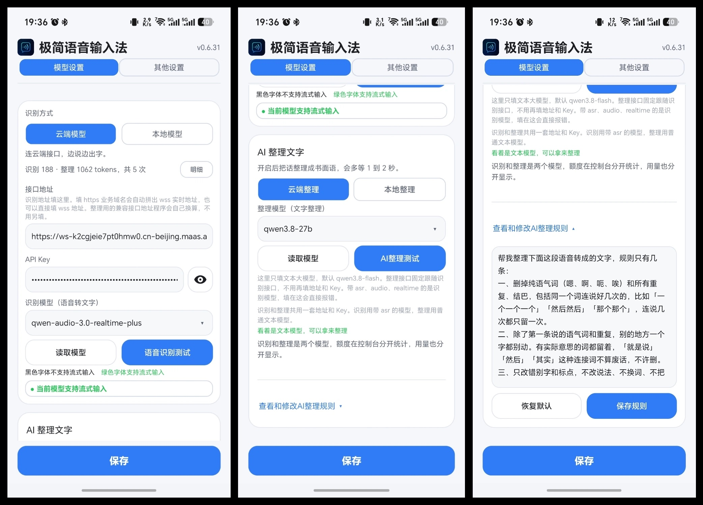
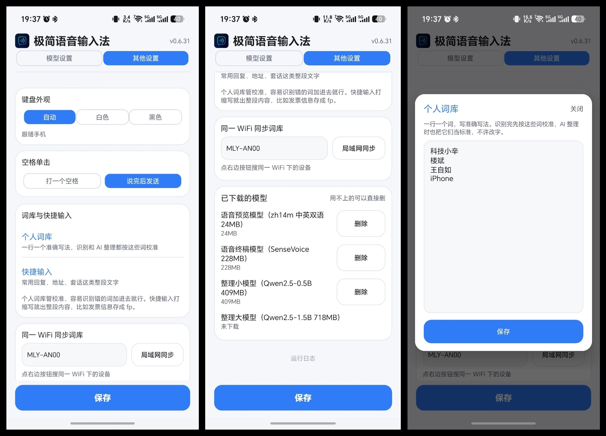

# 极简语音输入法 Minimal Voice IME

一个不占屏幕的安卓语音输入法。默认只留一条语音栏，按住说话，松手转成文字，AI 整理完点一下发送。需要手打的时候再展开全键盘，不需要为了说一句话先把整块键盘顶上来。

没有广告，没有推送，没有多余按键。云端识别可以走阿里云百炼，也可以切到本地模型，整条链路不联网。



左边是默认状态，只有一条窄窄的语音栏。右边是展开后的全键盘。平时聊天、发消息、记东西，用左边就够了。

## 为什么说它省屏幕

普通输入法一弹出来就是四排键盘，输入框上面的内容会被压掉一半。这个输入法默认只占一条，把屏幕留给聊天记录、文章、表格和你要看的内容。

- 按住中间那条说话，边说边出字
- 松手后 AI 自动去掉嗯、啊、重复和口头语，整理成能直接发的话
- 点一下发送，或者按设置补一个空格，不用再来回切键盘
- 想手打的时候按一下 ABC，展开全键盘，数字、字母、标点都在
- 不想用云端就切本地模型，录音和识别都不出手机

## 第一次使用怎么配

装好 APK 以后，按这个顺序来，五分钟左右能配好。

### 1. 把输入法启用起来

1. 打开手机「设置」，找到「系统」或「其他设置」里的「语言和输入法」。
2. 点「虚拟键盘」或「当前输入法」，把「极简语音输入法」打开。
3. 在输入框里长按，选「输入法」，切换到极简语音输入法。
4. 打开极简语音输入法的 App，进入「模型设置」。

### 2. 推荐先用阿里云百炼的免费额度

阿里云百炼新用户有免费模型额度，个人日常用语音识别和文字整理，先拿免费额度试最划算。

免费额度查询：[阿里云百炼免费额度](https://bailian.console.aliyun.com/cn-beijing/costing-balance/free-quota)

进去以后开通百炼，创建一个 API Key，复制下来填到输入法里。

### 3. 填接口地址和 API Key

在「模型设置」最上面填：

- 接口地址：普通百炼 Key 可以留默认的公共地址，也可以填 `https://dashscope.aliyuncs.com/compatible-mode/v1`
- API Key：填刚复制的 `sk-...`

如果你用的是 `sk-ws-` 开头的业务空间 Key，接口地址要填你自己的业务空间域名，程序会自己换算出识别、整理和流式地址。

### 4. 读取模型，选能用的

点「读取模型」。它会拉取这一类里真正能跑通的模型，跑不通的不显示。

- 识别模型只列语音模型，名字一般带 `asr`、`audio`、`realtime`
- 整理模型只列文本模型，比如 `qwen3.8-flash`
- 名字是绿色的模型支持流式输入，可以边说边出字
- 名字是黑色的模型不支持流式输入，松手后才开始转写

想边说边出字，识别模型选名字带 `realtime` 或 `streaming` 的，比如 `qwen3-asr-flash-realtime`。只想整段转写，用 `qwen-audio-3.1-asr-flash` 就行。



### 5. 两个测试按钮都点一下

- 「语音识别测试」：真的录一小段中英文，能转出文字才算通
- 「AI整理测试」：真的发一次整理请求，能返回整理后的文字才算通

识别和整理固定共用最上面这一套接口地址和 Key。下面不用再填整理地址，也没有同步和展开编辑窗口，少一个容易填错的地方。

### 6. 不想用云端就切本地

在「模型设置」里把识别方式切成「本地模型」，AI 整理也切成「本地整理」，模型在设置页里直接下，下载完就能离线用。云端那部分不填 Key 就不会被调用。

## 新版本里比较实用的地方

- 默认小键盘只占一条，不展开全键盘也能完成一整句话
- 支持流式识别，说话的时候字就往上走
- AI 整理会删掉语气词、重复和结巴，但保留有实际意思的词
- 识别模型下拉用绿色和黑色区分是否支持流式输入
- 「读取模型」按钮外面有一圈描边进度，和数字进度条、百分比同步
- 运行日志里错误行标红，「复制错误日志」只复制报错行，方便反馈问题
- 个人词库校准人名、公司名、产品名，AI 整理也不许改这些词
- 快捷输入打缩写直接出整段，比如地址、发票信息、常用回复
- 同一 WiFi 下可以把词库同步到另一台手机
- 键盘外观可以跟随系统，也可以固定浅色或深色



## 已经做到的事

语音

- 按住说话、松手定稿，说的时候字就往上走
- 上滑取消这次输入，已上屏的草稿一起清掉
- 录音时红色胶囊上是跟音量跳的波形，整理时是彩色跑马灯
- 转完字闪两下提示完成
- 三种主题：跟随系统、浅色、深色
- 录音期间自动静音外放，免得喇叭声被麦克风收进去

文字

- 离线拼音输入，自带 2.5 万词的词表，支持词组、自动分词组词
- 标点上滑、长按大写、中英切换
- 识别或整理时挂在输入框里的草稿带下划线，删除键能一个字一个字退掉
- 按键按下有放大回弹和振动反馈

模型

- 云端识别走阿里云百炼，边说边出字
- 本地识别走 sherpa-onnx，模型自己下，放 `filesDir`，不进 APK
- AI 整理也是本地和云端各一套，选本地模式就只用本地模型，选云端就只走云端
- 设置页能测模型、能删模型、能看云端 Token 用量和每次的明细

词库

- 个人词库：一行一个准确写法，专门放人名、公司名、产品名这类容易识别错的词。识别完先按这份词表校准，AI 整理也把它当标准，不许改字
- 快捷输入：常用回复、地址这类整段文字，打缩写整段上屏，缩写要打完整才出
- 一堆内容粘进去，AI 拆成缩写加正文，不用一条条录

## 模型怎么选

识别和整理是两类模型，别填反。

识别那栏只填语音模型：

- 整段识别：`qwen-audio-3.1-asr-flash`
- 边说边出字：`qwen3-asr-flash-realtime`

整理那栏只填普通文本大模型：

- `qwen3.8-flash`
- 其他百炼文本模型也可以，点「读取模型」会帮你筛

本地模型档位：

- 识别标准档，约 228MB：24MB 流式预览边说边出字，松手用 SenseVoice int8 出终稿
- 识别高精度档，约 903MB：同一个流式预览，松手用 whisper medium int8 出终稿，中英混说更稳
- AI 整理小模型，约 409MB；大模型，约 718MB；也可以选「自定义」，填一个 GGUF 直链，推荐 0.5B 到 1.5B 的 instruct 版本

模型文件夹在 `filesDir/models`，设置页「其他设置」下面能看已下载的，也能删。

## 怎么编译

需要 JDK 17、Android SDK 34、Gradle 8.7。用 Android Studio 打开 `安卓版` 这一层目录直接跑也行。

命令行：

```bash
export JAVA_HOME=/path/to/jdk17
./gradlew assembleDebug
```

产物在 `app/build/outputs/apk/debug/app-debug.apk`，只打 arm64-v8a。首次编译会从 Maven 拉依赖，国内建议配好镜像。

仓库里没有放工具链，`devtools/`（JDK、Gradle、Android SDK）是自己装在本地的，已经在 `.gitignore` 里。APK 也不进仓库，去 Releases 拿。

## 代码在哪

```
app/src/main/java/com/minivoice/ime/
├── service/MinimalVoiceIME.java   输入法本体，按键、全键盘、候选、录音、状态刷新
├── input/PinyinDict.java          离线拼音词表、分词、组词
├── data/PhraseStore.java          快捷输入的存储与缩写匹配
├── data/PhraseAi.java             粘一段内容让 AI 拆成词条
├── data/PhraseParser.java         纯 Java 解析，能脱离安卓单独跑
├── asr/
│   ├── RealtimeAsrEngine.java     云端流式识别
│   ├── BailianAsrEngine.java      整段上传兜底
│   ├── LocalAsrEngine.java        sherpa-onnx 本地识别
│   ├── AsrConfig.java             Key、域名、模型
│   ├── TextPolisher.java          AI 整理
│   ├── LlmPolisher.java           本地模型整理
│   └── TermFix.java               固定名词和英文大写
├── audio/AudioRecorder.java       16k 单声道录音
├── sync/LanSyncManager.java       局域网同步
├── settings/Prefs.java            全部本地配置，含 Token 统计
└── ui/                            设置页、主题、波形和跑马灯
```

拼音词表在 `app/src/main/assets/`，`pinyin_words.txt` 和 `pinyin_chars.txt`，从 jieba 词频筛出来的。

## 已知的坑

- 荣耀的「敲一敲」截屏，键盘弹着的时候用不了，试过 `FLAG_NOT_TOUCH_MODAL` 无效。
- 豆包、微博这类 App 点发送后会自己收键盘，任何第三方输入法都一样，属于 App 行为，硬弹回来反而更乱。
- 拼音表只收了词频 100 以上的词，很冷僻的词和个别长串会切得不够漂亮。
- ARM 的 Mac 上开安卓模拟器需要虚拟化权限，某些环境跑不起来，这部分只能真机验。

## 许可

MIT，见 LICENSE。
