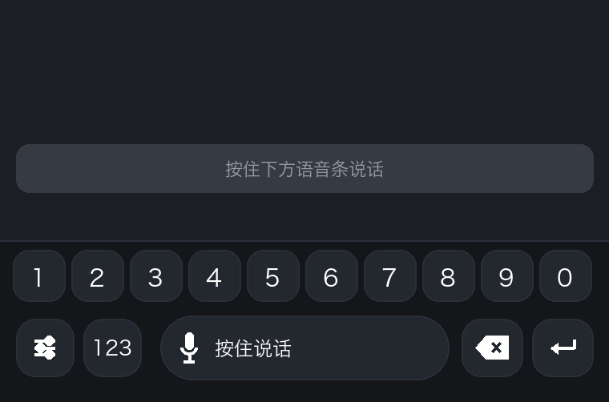
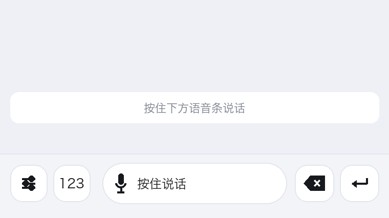

# 极简语音输入法

一个只干一件事的安卓输入法：按住说话，松手出字。没有全键盘，没有候选栏，没有广告，底部只有五个键。

识别走阿里云百炼的语音模型，支持边说边出字。也可以切到本地模型，整条链路不联网。

## 长什么样

收起状态就一条，五个键。




- 最左：设置
- 左二：123 与麦克风切换，点开是横向一排数字，每格上滑打标点
- 中间：语音条。按住说话，刚转完的 20 秒内单击等于发送
- 右二：删除，长按连删
- 最右：回车，短按发送，长按换行

## 已经做到的事

- 按住说话、松手定稿，说的时候就能看到字往上走
- 上滑取消这次输入，已上屏的草稿一起清掉
- 录音时红色胶囊上是跟着音量跳的波形，整理时是彩色跑马灯
- 转完字闪两下提示完成
- 三种主题：跟随系统、浅色、深色
- 录音期间自动静音外放，免得喇叭声被麦克风收进去
- 固定名词纠正，英文缩写（CPU、ETC 这类）自动大写
- 可选的 AI 整理，把口语稿理成书面语，失败一律回落原文
- 本地模型：说话时流式小模型出预览，松手用大模型整段重算终稿
- 局域网内两台设备同步词表和标点规则

## 怎么编译

需要 JDK 17、Android SDK 34、Gradle 8.7。用 Android Studio 打开这一层目录直接跑也行。

命令行：

```bash
export JAVA_HOME=/path/to/jdk17
export ANDROID_USER_HOME=$PWD/.android-home
./gradlew assembleDebug
```

产物在 `app/build/outputs/apk/debug/app-debug.apk`，只打 arm64-v8a。

## 识别服务怎么配

仓库里没有内置 Key，源码里的默认值是空串。装完第一次打开设置页，填自己的：

- API Key：阿里云百炼控制台申请，`sk-ws-` 开头的业务空间 Key 必须配业务空间专属域名
- 请求地址：形如 `https://<你的业务空间域名>/api/v1/services/aigc/multimodal-generation/generation`
- 模型：`qwen-audio-3.1-asr-flash`
- 流式实时：`wss://<域名>/api-ws/v1/realtime?model=qwen3-asr-flash-realtime`
- AI 整理走兼容接口 `https://<域名>/compatible-mode/v1/chat/completions`，模型 `qwen3.8-flash`

如果你自己编译、想让它装完就能用，把 Key 写进 `local.properties`（这个文件不会进仓库）：

```properties
bailian.key=sk-ws-你自己的key
```

## 本地模型

设置页里可以自己下，走 hf-mirror 镜像：

- 流式预览：sherpa-onnx streaming zipformer 中文 14M，约 24MB
- 终稿重算：SenseVoice int8，约 239MB，带标点和数字转换

模型放 `filesDir`，不放进 APK，所以安装包本身很小。

## 代码在哪

```
app/src/main/java/com/minivoice/ime/
├── service/MinimalVoiceIME.java   输入法本体，按键、录音、上滑取消、状态刷新
├── asr/
│   ├── RealtimeAsrEngine.java     云端流式识别
│   ├── BailianAsrEngine.java      整段上传兜底
│   ├── LocalAsrEngine.java        sherpa-onnx 本地识别
│   ├── AsrConfig.java             Key、域名、模型
│   ├── TextPolisher.java          AI 整理
│   └── TermFix.java               固定名词和英文大写
├── audio/AudioRecorder.java       16k 单声道录音
├── sync/LanSyncManager.java       局域网同步
├── settings/Prefs.java            全部本地配置
└── ui/                            设置页、主题、波形和跑马灯
```

## 已知的坑

- 微博的表情面板是按输入法窗口高度排版的，键盘只有一条那么高，面板就会跟着被压扁。微博里键盘顶上有个小箭头，点一下把窗口垫高，再点表情就能铺开。
- 荣耀的「敲一敲」截屏，键盘弹着的时候用不了，试过 `FLAG_NOT_TOUCH_MODAL` 无效。
- 豆包这类 App 点发送后会自己收键盘，任何第三方输入法都一样，属于 App 行为。

## 许可

MIT，见 LICENSE。
